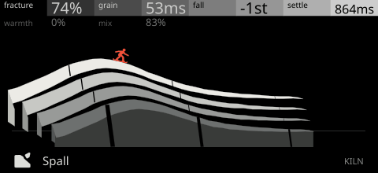

# KILN

**Eight stereo send effects for the Teenage Engineering OP-XY.** Put a kick and a bass on the same send and Collision lets the kick roughen the bass. Put a rimshot over a held chord and Spall catches a piece of the chord, then bends it down into the gap after the hit.



KILN runs once on the stereo sum of each send. Tracks feeding FX I interact with one another. A second KILN on FX II gets its own controls, audio history and rider. The image above is rendered from the release display code.

## Play it

Choose KILN on **FX I** or **FX II**, then raise the matching send on an instrument track. **Hold Shift and turn K1** to select a mode. The four encoders edit the controls named in the highlighted row. **Press any encoder** to switch rows. On the alternate row, **K2** blends the processed and dry signal inside KILN.

| Mode | Try it with | Listen for |
| --- | --- | --- |
| Collision | Kick and bass on one send | The grit that appears when the two bands hit the shaper together |
| Transient Space | A dry pluck | Four short reflections spreading its attack across the stereo field |
| Formant | A sustained saw | Accents pushing a resonant vowel forward |
| Stereo Gate | A wide pad | Independent left and right rhythms across sixteen steps |
| Dynamic Dirt | Snare and hats | A sharp edge on the attack with weight underneath |
| Memory Drive | A loud accent followed by quiet notes | The accent changing how the following notes break up |
| Tuned Dirt | A short bass note | Distortion ringing at the root and fifth |
| Spall | A chord and a rimshot | A short stereo fragment peeling away and dropping in pitch |

[Illustrated manual and control reference](docs/MANUAL.md)

## Build it

**With TE Builder**, import the repository ZIP through **Add machine / Import source**, select KILN 0.2.5 and build your collection with the **4 MiB** profile. The machine bundle declares its meter integration.

**Standalone**, extract the ZIP and run these commands from the folder containing `build.py`. This example uses macOS, Python 3.12 and your own stock OP-XY OS 1.2.1 file. The first command installs the pinned Blackfin tools.

```sh
python3.12 build.py tools
python3.12 build.py build --stock-os "$HOME/Downloads/os.ldr" --out "$HOME/Downloads/kiln-025-build"
```

The standalone firmware includes KILN as its sole custom machine. Use TE Builder for a collection containing your other machines. The release includes the SDK source and both patches. [Build options, offline setup and output files](docs/BUILD.md)

**Release 0.2.5** passed on OP-XY hardware, including the rider response at quiet send levels. [Release notes](docs/RELEASE.md) · [GPL-3.0](LICENSE)
