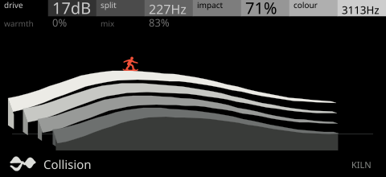
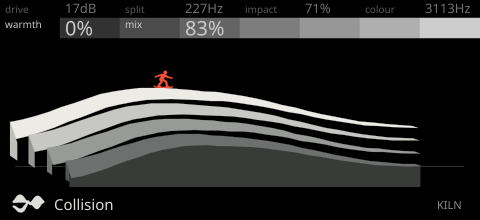
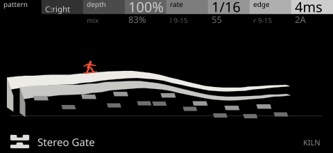
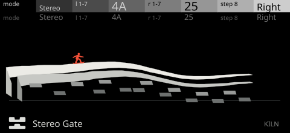
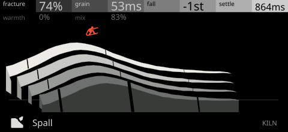

# Playing KILN

## Hear the interaction

Select KILN on FX I. Route a short kick and a sustained bass to that send. In **Collision**, turn up Drive, then mute the kick for one bar. Listen to the change in the bass each time the kick returns. Bring up Impact for more low-mid weight. Press an encoder and turn K1 to round the rough edge with Warmth.

## Find a control

| Gesture | What it does |
| --- | --- |
| Hold Shift and turn K1 | Selects one of eight modes |
| Turn K1–K4 | Edits the four controls on the highlighted row |
| Press any encoder | Switches between main and alternate rows |
| Turn alternate K1 | Sets Warmth in Collision, Dynamic Dirt and Spall |
| Turn alternate K2 | Sets Mix in every mode |
| Hold Shift in Stereo Gate | Shows the mode and the first half of each custom gate row |

The **track send** sets how much of that instrument reaches the effect. **Mix** sets how much processing KILN applies to the audio it receives. At full send, 0% Mix passes that audio through and 100% gives the processed sound. Start with the default **83% Mix**. For a gate that falls completely silent, set track send, Mix and Depth to maximum.

## Main row

| Mode | K1 | K2 | K3 | K4 |
| --- | --- | --- | --- | --- |
| Collision | Drive | Split | Impact | Colour |
| Transient Space | Size | Focus | Width | Damping |
| Formant | Vowel | Shift | Resonance | Motion |
| Stereo Gate | Pattern | Depth | Rate | Edge |
| Dynamic Dirt | Drive | Tilt | Focus | Wear |
| Memory Drive | Drive | Memory | Recovery | Bias |
| Tuned Dirt | Drive | Root | Ring | Damping |
| Spall | Fracture | Grain | Fall | Settle |

**Collision.** Split sets where the low and high bands meet. Drive pushes their interaction into distortion, Impact brings back low-mid weight, and Colour shapes the top end. Use both tracks on the same FX slot to hear them interact.

**Transient Space.** Size sets the spacing of four short reflections. On a pluck, sweep Focus to hear how much of the attack or body enters the reflections. Width moves their weight between the channels. Damping softens the tail.

**Formant.** Start with a harmonically rich tone and turn Vowel through Ah, Eh, Ee, Oh and Oo. Shift moves the resonances in semitones. Raise Motion on an accented sequence to let the performance move the vowel.

**Dynamic Dirt.** Use a drum loop. Set Drive, balance the tone with Tilt and vary Focus and Wear while listening to the space between hits. The noise follows the signal. Compare Warmth at both ends of its range with Drive held steady.

**Memory Drive.** Place a loud note before several quiet notes of the same pitch. Raise Memory and extend Recovery. Listen to the first quiet note, then the last one as the drive recovers. Bias changes the asymmetry.

**Tuned Dirt.** Set Root to the key of a short bass phrase. Ring brings up the pitched residue of the clipping, with the two delays tuned a fifth apart. Damping shortens or softens the ring. Leave a gap after each note to hear it.

## Program a stereo gate

The two front rows show left and right. Read each from left to right. Start with **Hocket** and a sustained pad, select **1/16** with K3, and turn Edge up if you want softer openings. The gate follows the running transport and keeps stepping at the current tempo when transport stops.

Main K1 offers four factory patterns, then four **Custom** positions. All four Custom positions edit the same pattern. Their difference is what opens on step 16.

| Steps | Control | What to watch |
| --- | --- | --- |
| 1–7 | Shift K2 for left, Shift K3 for right | Turn through the mask values and watch the seven cells change |
| 8 | Shift K4 | Rest, Left, Right or Both |
| 9–15 | Alternate K3 for left, alternate K4 for right | The seven cells in the second half of each row |
| 16 | Main K1 in its four Custom positions | C:rest, C:left, C:right or C:both |

For a quick stereo check, start with both masks on each side at zero. Set step 8 to **Left** and turn main K1 to **C:right**. At full Depth and Mix you should hear a left hit halfway through the cycle and a right hit at its end. Selecting a factory pattern preserves the custom masks for your return.

## Catch a fragment with Spall

Send a held chord and a rimshot to one instance. Put the hit just before a chord change, then just after it. Spall captures a short piece of the sound preceding the hit. Which chord rings out depends on when you strike. After silence, an isolated pitched attack can also start a fragment by collecting its opening grain.

| Control | What you hear |
| --- | --- |
| Fracture | Sets fragment amount and detection sensitivity |
| Grain | Sets the captured window, 18–133 ms |
| Fall | Bends the fragment down by up to 18 semitones across its tail |
| Settle | Sets tail duration, 75–1555 ms |
| Alternate K1, Warmth | Softens the repeating fragment |

Grain, Fall and Settle take effect at capture. Compare them on successive hits. Two fragments can overlap. A third hit takes the older fragment’s place.

## Read the landscape

The four main controls shape the relief. Mix flattens it toward dry, and Warmth rounds the crest in its three modes. The rider follows the level and accents of the stereo return on the displayed send. A stronger attack can lift it off the ridge. In Spall the fracture travels left underneath it. Let the tail die and the rider comes to rest.

## Levels and project recall

KILN measures dry and processed energy on each stereo send. Most modes use slow stereo-linked gain correction, with extra attenuation available in Tuned Dirt to contain sustained ringing. Stereo Gate retains its programmed dynamics. When balancing several instruments into one KILN, set their relative track sends first and listen through a few bars.

Save the project after editing. Each pattern’s FX I and FX II retain their respective modes, main controls, Mix, Warmth and custom gate settings. Selecting another mode reuses the four main knob positions. Delay tails and envelope history start fresh when the effect initializes.

Projects saved with the eight-mode 0.2.x layout keep that mapping. When opening a project from **0.1.1**, reselect the intended mode on each affected pattern and send, check steps 1–8 of each gate row, then save.
